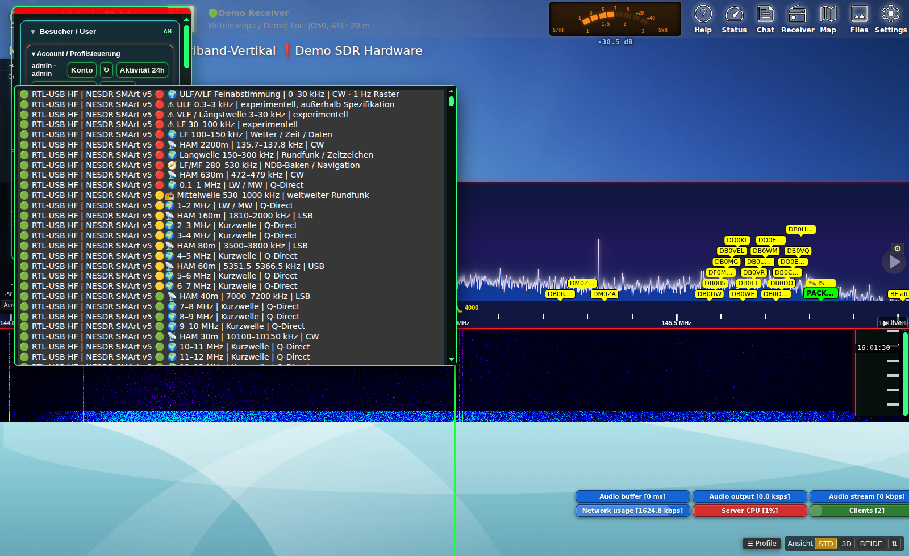
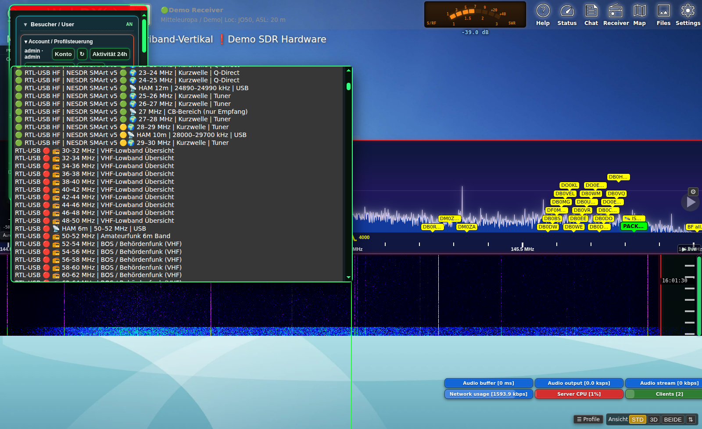
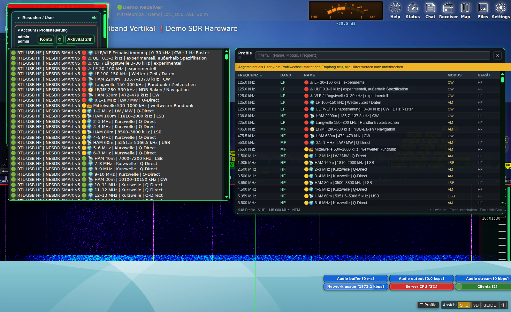
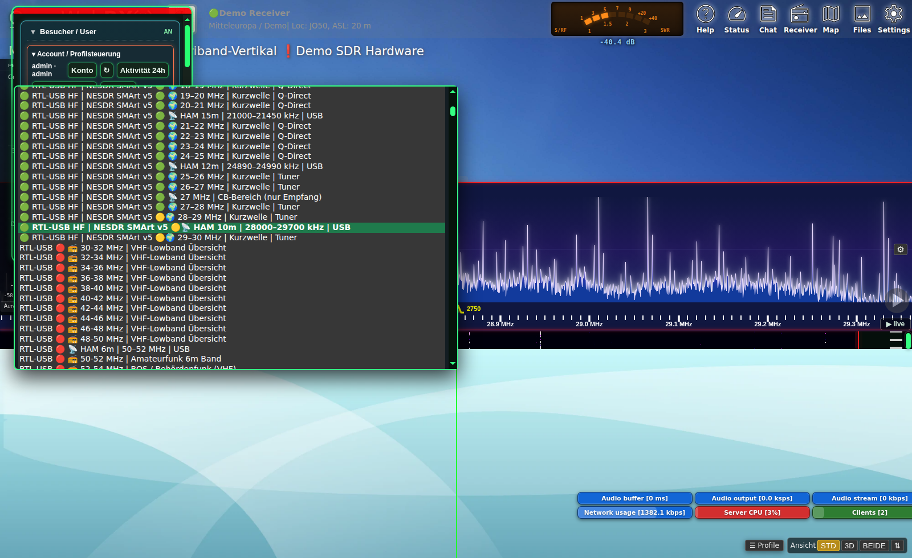

# DNX Profil-Sortierung (`v1.0.1`)

<!-- DNX-DISCLAIMER-START -->
> **Wichtiger Hinweis / Vollständige Distanzierung (Hobby-Mod-Mode)**
>
> - **Vollständige Distanzierung:** Ich distanziere mich in jeder Hinsicht vollständig vom Projekt **OpenWebRX / OpenWebRX+** sowie dessen Entwicklern und Betreibern. Es besteht keinerlei Verbindung, Zusammenarbeit, Prüfung, Befürwortung oder Partnerschaft.
> - **Keine öffentlichen/offiziellen OpenWebRX-Plugins (nur Mod-Mode):** Bei diesem Projekt handelt es sich ausdrücklich **nicht** um ein öffentliches oder offizielles Plugin von OpenWebRX, sondern ausschließlich um einen privaten, inoffiziellen **Mod-Mode** (Eigenmodifikation).
> - **Warum bewusst kein reines Browser-JavaScript (Mod-Mode-Architektur):** Viele Funktionen (z. B. serverseitige Speicherung, Konten-/Rollenverwaltung, Profil-Synchronisation, VNC-/websockify-Brücken, geschützte Schnittstellen, Docker-/Systemintegration und stabile UI-Anpassungen) lassen sich sauber und sicher nicht allein über simples Client-JavaScript umsetzen, ohne den OpenWebRX-Kern umzubauen oder Browsergrenzen zu umgehen. Deshalb setzt dieses Projekt bewusst auf getrennte Begleitmodule, Shell-Installer und Dienste im **Mod-Mode** statt alles künstlich in reines JavaScript zu pressen.
> - **Kein öffentlicher Support & keine Haftung:** Es gibt **keinen öffentlichen Support**, keine Garantie und keine Haftung. Nutzung, Installation und Anpassung erfolgen vollständig auf eigene Gefahr (immer vorher Backups anlegen und zunächst im eigenen Testsystem prüfen).
> - **Reines Hobbyprojekt – frei nutzbar, änderbar & verbreitbar:** Dieses Projekt entsteht ausschließlich aus reinem Hobby und Interesse am gemeinsamen Funk-/SDR-Hobby. Es steht ausdrücklich frei zur Verfügung und darf frei genutzt, weiterverbreitet, verändert und verbessert werden.
<!-- DNX-DISCLAIMER-END -->

> **Important Notice / Full Disassociation (Hobby Mod-Mode Only)**
>
> - **Full Disassociation:** I completely disassociate myself from **OpenWebRX / OpenWebRX+** and its developers/maintainers. There is no affiliation, endorsement, review, or partnership of any kind.
> - **No Official/Public OpenWebRX Plugins (Mod-Mode Only):** These files are **not** official or public OpenWebRX plugins, but purely unofficial hobby modifications (*mod-mode*).
> - **No Public Support & No Warranty:** There is **no public support**, no warranty, and no liability. Use entirely at your own risk.

<!-- DNX-PREVIEW-START -->
## Live-Vorschau & Galerie (`DNX Profil-Sortierung`)



| Ansicht | Beschreibung | Screenshot |
|---|---|---|
| **Aufsteigende Sortierung ab `ULF`** | Das Profil-Aufklappmenü beginnt sauber bei `ULF 0.3-3 kHz` → `VLF 3-30 kHz` → `LF 30-100 kHz` → `LF 100-150 kHz` statt mitten im Spektrum |  |
| **Nahtloser Übergang HF → VHF** | Profile mehrerer SDRs (`HAM 10m` → `CB-Funk` → `30-32 MHz` → `6m` → `UKW`) erscheinen fortlaufend nach Frequenz geordnet |  |
| **Vergleich Menü & Profiltabelle** | Einheitliche aufsteigende Reihenfolge im Profil-Dropdown parallel zur `☰ Profile`-Übersichtstabelle |  |
| **Auswahl bleibt beim Wechsel erhalten** | Aktives Profil (`CB-Funk` / `HAM 10m`) bleibt nach jedem Neusortieren oder Neuaufbau der Liste exakt selektiert |  |
<!-- DNX-PREVIEW-END -->

Bringt das **Profil-Aufklappmenü** des Receivers in eine klare Reihenfolge: **von der niedrigsten zur höchsten Frequenz** (aufsteigend).

## Warum

OpenWebRX stellt die Profile so dar, wie sie in der Konfigurationsdatei stehen. Kommt später ein zweites Gerät dazu, hängen dessen Profile hinten an – und die Liste beginnt mitten im Spektrum:

```text
vorher:
   1. 🔴 📻 30-32 MHz      (31,0 MHz)   ← Liste beginnt hier
   2. 🔴 📻 32-34 MHz      (33,0 MHz)
   ...
 897. 🔴 📻 1748-1750 MHz  (1749 MHz)
 898. 🟢 🎙️ CB-Funk        (27,0 MHz)   ← erst jetzt das HF-Gerät
 ...
 948. 🔴 ⚠ VLF 3-30 kHz    (0,125 MHz)  ← die tiefste Frequenz am Ende
```

```text
nachher:
   1. 🔴 ⚠ ULF 0.3-3 kHz   (0,125 MHz)
   2. 🔴 ⚠ VLF 3-30 kHz    (0,125 MHz)
   3. 🔴 ⚠ LF 30-100 kHz   (0,125 MHz)
   4. 🔴 🌍 LF 100-150 kHz  (0,225 MHz)
   ...
 948. 🔴 📻 1748-1750 MHz  (1749 MHz)
```

## Funktionen & Grenzen

- Liest die Frequenzen automatisch aus `static/plugins/wf_profiles.json` – derselben Datei, die auch die DNX-Profiltabelle (`☰ Profile`) nutzt.
- Ordnet alle Einträge im Aufklappmenü aufsteigend nach Frequenz; bei gleicher Mittenfrequenz gilt in **`v1.0.1`** zusätzlich die Unterkante aus dem Profilnamen (`ULF 0,3–3 kHz` vor `VLF 3–30 kHz` vor `LF 30–100 kHz`).
- Profile ohne bekannten Frequenzeintrag wandern ans Ende; das aktuell gewählte Profil bleibt jederzeit erhalten.
- **Keine** Änderungen an `settings.json`, **kein** Eingriff in Rollen-/Profilrechte, und die eigenständige DNX-Profiltabelle bleibt unberührt.

## Installation (`install.sh`)

```bash
chmod +x install.sh
sudo ./install.sh install
```

Der Installer erkennt das Plugin-Verzeichnis auf drei Wegen – **Docker ist nicht nötig**:

```bash
sudo PLUGINS=/pfad/zu/plugins ./install.sh install   # direkt, ohne Docker
sudo CONTAINER=openwebrx ./install.sh install        # Mountpunkt aus Docker
sudo ./install.sh install                            # Standardsuche
sudo NORESTART=1 ./install.sh install                # ohne Container-Neustart
```

Prüfen, aktualisieren und restlos entfernen:

```bash
./install.sh status
sudo ./install.sh update
sudo ./install.sh uninstall
```

## Veränderte Stellen

1. `<plugins>/receiver/dnx_profil_sort.js` – Sortierlogik im Browser
2. `<plugins>/receiver/init.js` – eigener Loader-Block zwischen `/* DNX_PROFIL_SORT_START */` und `/* DNX_PROFIL_SORT_END */` (`init.js` wird vorab unter `/opt/dnx-profil-sortierung-backups/<Zeitpunkt>/` gesichert)

## Rechtlicher Hinweis / Disclaimer

**DE:** Private, inoffizielle Hobby-Anpassung (Mod-Mode) für OpenWebRX / OpenWebRX+. Kein offizielles OpenWebRX- oder OpenWebRX+-Projekt, keine Verbindung zu oder Unterstützung durch die jeweiligen Entwickler. Nutzung erfolgt vollständig auf eigene Gefahr; soweit gesetzlich zulässig wird jede Haftung ausgeschlossen. Vor dem Einspielen bitte Sicherungen anlegen.

**EN:** Private, unofficial hobby modification (Mod-Mode) for OpenWebRX / OpenWebRX+. Not an official OpenWebRX or OpenWebRX+ project; no affiliation with or support from its maintainers. Use entirely at your own risk; to the extent permitted by law, no liability is accepted. Always create backups before installing.
